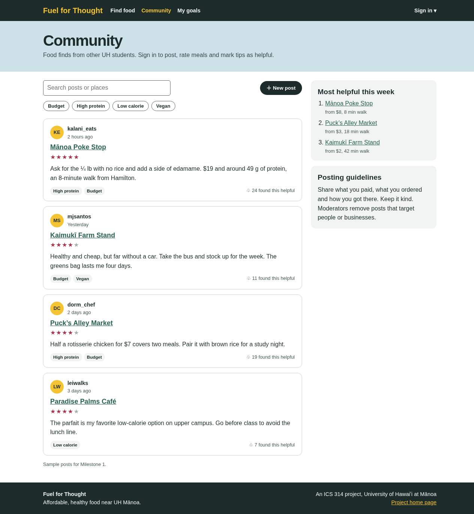
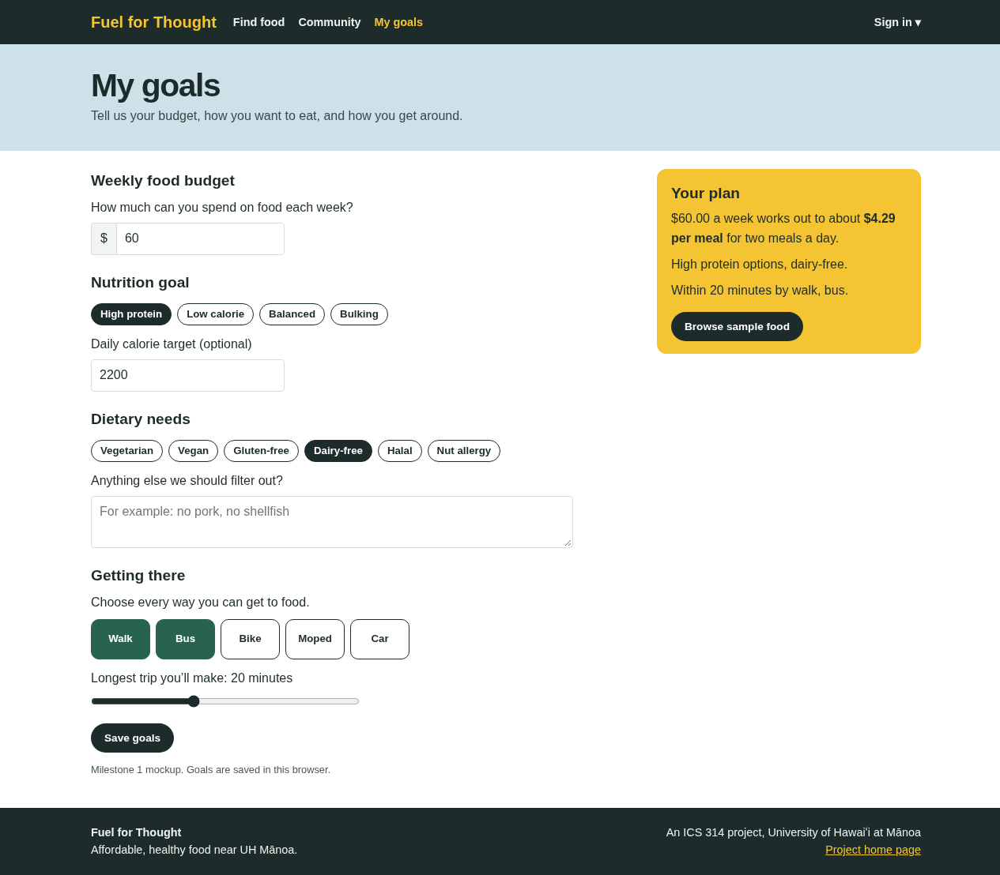
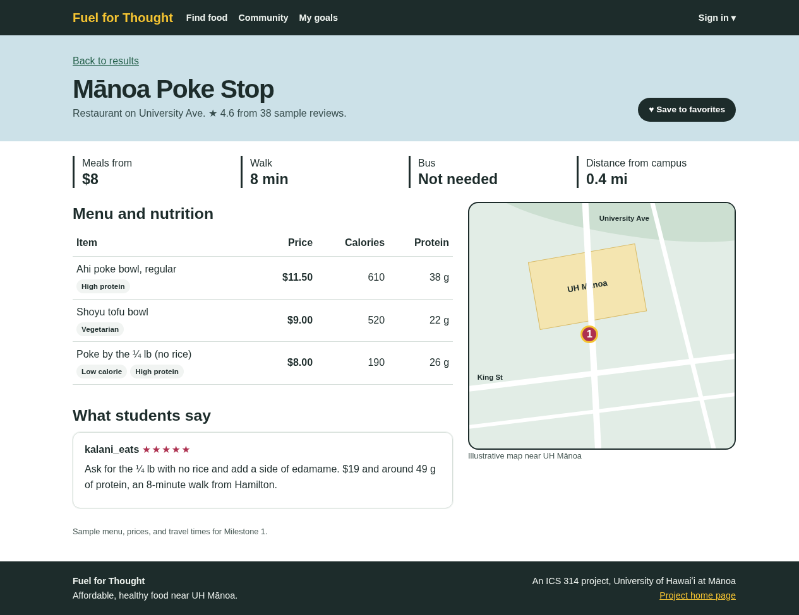

# Fuel-For-Thought

## Table of contents

* [Description](#description)
* [Deployment](#deployment)
* [Goals](#goals)
* [Overview](#overview)
* [Mockup-Pages](#mockup-pages)
* [Team-Contract](#team-contract)
* [Github-Organization](#github-organization)
* [Milestones](*milestones)

## Description

The Fuel-For-Thought website helps college students at The University of Hawaii at Manoa find meals that fit their budget, dietary needs, fitness goals, and transportation options. Students can discover options from restaurants, grocery stores, and campus dining, then compare prices, nutrition information, and travel distance before deciding where to eat. Students who sign in with a UH email address can also share recommendations, rate meals, and save their favorite finds.

## Deployment

<a href="https://fuel-for-thought.vercel.app/">Fuel-For-Thought Vercel</a>

Link to the Fuel-For-Thought Vercel

## Goals

- Make affordable meals easier to find. Let students search within their budget and compare prices across restaurants, grocery stores, and campus dining options.

- Help students find meals that fit their dietary needs. Let students filter by preferences and restrictions, such as vegan options, and view calories and ingredients when available.

- Show students which options they can reach. Use travel distance and available transportation options to surface practical choices for students who walk, take the bus, or drive.

- Build a safe student-led interactive community. Give signed-in students a place to post meal recommendations, write reviews, and rate options so others can decide what’s worth trying.

## Overview

The application will use several technologies covered in ICS 314, including the following.

- React for building interactive components such as meal listings, search filters, and review forms.

- React Bootstrap for designing responsive page layouts, navigation, and meal cards.

- PostgreSQL for storing user accounts, vendors, meals, reviews, and favorites, along with the relationships between them.

- VS Code, ESLint, and GitHub for writing code, checking coding standards, collaborating on changes, and tracking milestone tasks.

The application will also demonstrate several design concepts.

- Related database tables that connect meals to vendors, reviews to their authors, and favorite meals to the users who saved them.

- A public browse page where students can filter meals by price or dietary preference and compare nutrition information and distance.

- Account registration and sign-in pages that give students access to posting, reviewing, and saving meals.

- Role-based permissions that let visitors browse listings, signed-in students contribute, and administrators moderate posts.

## Mockup-Pages

<iframe src="./Mockups.pdf" title="Fuel for Thought website mockups" width="100%" height="650"></iframe>

[Open the mockup PDF](./Mockups.pdf)

The landing page introduces Fuel for Thought and gives students a place to get started, while the Goals page lets them save their weekly food budget, nutrition goals, dietary needs, and transportation options. The search page displays nearby restaurants, grocery stores, and campus dining options alongside a map so students can compare prices and distances. The Community Dashboard lets students share and rate food recommendations and filter posts for budget-friendly, high-protein, or low-calorie options.

### Community landing page

The Community mockup is the app’s landing page. Students can search sample food recommendations, filter by budget or dietary tags, and see the week’s most helpful posts.

### My goals

The My goals mockup lets students set a weekly budget, nutrition goals, dietary needs, and travel preferences. The plan panel shows the estimated cost per meal as they make changes.

### Mānoa Poke Stop — Place details

The Place details mockup shows how students can compare sample prices and nutrition, check travel time from campus, and read a student review before choosing where to eat.

## Team Contract
<a href="https://docs.google.com/document/d/e/2PACX-1vT1X-l-g6en61Bl6EDyLUo0cAefKqoeDVzzF8YXy68kyon3Q86qhM3s4A1r5FZ0BK-Ewbm1j6nWUIFG/pub" target="_blank" rel="noopener noreferrer">Click Me to Open Team Contract</a>

## Github-Organization
<a href="https://github.com/fuel-for-thought" target="_blank" rel="noopener noreferrer">Fuel-For-Thought Github Organization</a>

## Milestones 

Link For M2 - <a href="https://github.com/orgs/fuel-for-thought/projects/4/views/1" target="_blank" rel="noopener noreferrer">Milestone 2</a>
